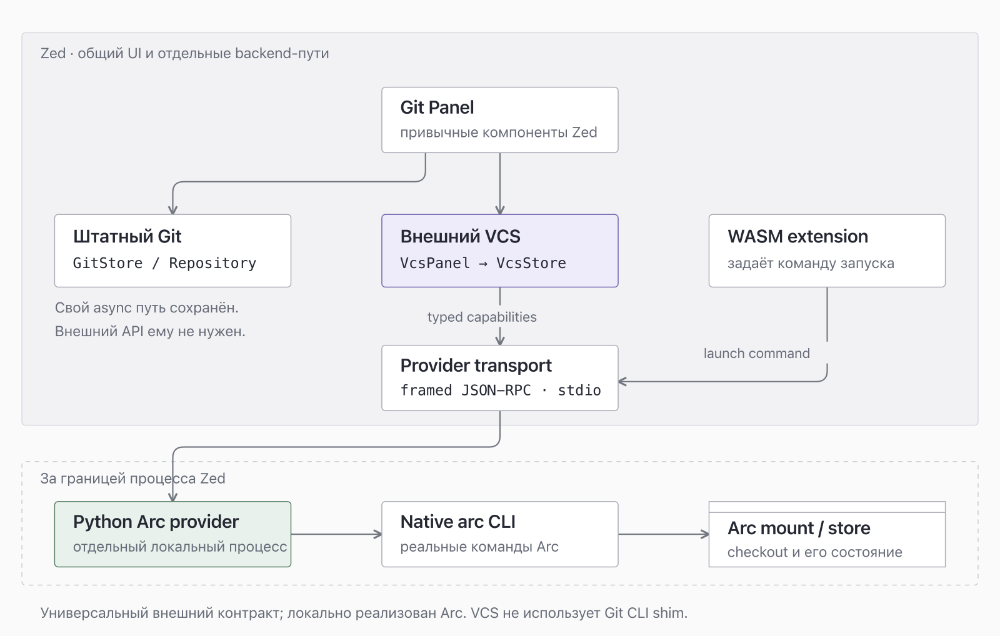
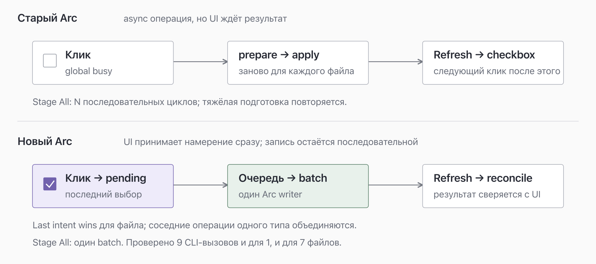

# Zed и внешний VCS: что добавлено в fork

Срез на 22 октября 2026 года.

Fork добавляет API внешних VCS. Локальный Arc provider подключает diff, staging,
историю файла и checkout workflow к привычному Git Panel. Штатный Git backend
сохранён; у Git и внешнего provider разные backend-пути.

Общий core включён в `main` fork в merge
[`b232e6f54b09a6baeb21228549028960cc9855be`](https://github.com/Nol1feee/zed/commit/b232e6f54b09a6baeb21228549028960cc9855be).
Это опубликованный core, не подтверждение установки merge или принятия в upstream.

> **Граница поставки:** private Arc Python/WASM adapter, окружение и материалы
> проверки не опубликованы. Готовой установки Arc нет. API допускает другие
> провайдеры, но не предоставляет их реализации.

## Точка сравнения {#comparison-baseline}

Возможности сравниваются со stock Zed, staging — с прежним Arc. Оба старых пути,
Git и Arc, уже были async.

| Объект                    | Проверенная версия                                       | Что означает сравнение                               |
| ------------------------- | -------------------------------------------------------- | ---------------------------------------------------- |
| Stock Zed                 | `1.25.2`                                                 | Stock-сборка для сравнения workflow.                 |
| Проверенная custom-сборка | `1.26.0-dev`, `f528b6d237a4197574884fe328d569a7af0ab0d1` | Snapshot локальных проверок staging.                 |
| Общий код в `main` fork   | `b232e6f54b09a6baeb21228549028960cc9855be`               | Merge core, отдельный от установленной сборки.       |
| База исторического diff   | Upstream main `1f32ec0ceafddd6a368db8aef9d169a6569a1c23` | Не точная stable-база установленной версии `1.25.2`. |

Исторический diff feature-ветки до указанной upstream-базы содержит **16 коммитов,
100 файлов, +31 155 / −1 102 строк**. В него входят тесты, fixtures и API
snapshots. Это не 31 тысяча строк production-кода и не статистика всех различий
нынешнего `main` с upstream.

## Как развивалась интеграция {#integration-milestones}

1. **G1:** read-only API и diff;
   [исторический PR #65853](https://github.com/zed-industries/zed/pull/65853).
2. **G2:** guarded mutations, scope authority, owned checkout lifecycle, agents.
3. **Следующие итерации:** stock-компоненты Git Panel, история/blame, pending UI,
   очередь, batch staging и диагностика backend.

Этапы fork не означают принятия G2 или Arc в upstream.

## Архитектура: общий UI, два backend-пути {#architecture}

[Редактируемый SVG схемы](./vcs-overview/architecture.svg).

Сверху находится общий UI. Для Git сохраняются `GitStore / Repository`. Для
внешней VCS адаптер `VcsPanel` связывает интерфейс с `VcsStore` и typed
capabilities. Git не перенесён на внешний JSON-RPC-протокол.

`VcsStore` обращается к provider process через **framed JSON-RPC поверх stdio**.
WASM extension задаёт команду запуска. Python Arc provider вызывает native `arc`
CLI, работающий с mount/store.

Provider определяется по project markers и ownership с учётом Workspace Trust.
Глобального Git/Arc selector в Settings нет. Окружение adapter задаёт команду Arc,
root и owner policy; общие настройки Git Panel управляют оформлением.

Git CLI shim в VCS-пути нет. Прежняя интеграция Go language server (LSP) остаётся
отдельной и не входит в VCS transport.

Схема включает private Arc adapter для объяснения полного пути. Его исходники
не опубликованы. Общий контракт: [VCS providers](./vcs-providers.md).

## Исправления производительности: разные причины {#performance-history}

| Причина                                                      | Изменение                                                                                                                      | Что подтверждено                                                                |
| ------------------------------------------------------------ | ------------------------------------------------------------------------------------------------------------------------------ | ------------------------------------------------------------------------------- |
| Фоновый `repository_state` запускал Arc status на всём mount | Чтение ограничено scope открытого проекта. Полные preflight-проверки перед Commit и Switch сохранены.                          | Whole-checkout status исчез из наблюдаемого окна. Курсор ещё тормозил.          |
| Неоптимизированный core тормозил при движении курсора        | При тех же исходниках и том же provider core пересобран в `release-fast` с `debug=0`.                                          | Подтверждена субъективная плавность; input latency/FPS не измерялись.           |
| RPC Arc daemon отвечал `Connection refused`                  | Backend восстановлен с прежним store; provider сообщает `backendUnavailable` вместо ложного сообщения об отсутствии authority. | PID и `mounted` не доказывают healthy RPC. Глубинная причина отказа неизвестна. |

## Staging: намерение сразу, запись последовательно {#staging-behavior}

[Редактируемый SVG схемы](./vcs-overview/staging-flow.svg).

Старый Arc уже async, но UI ждал запись перед checkbox и держал global busy.
Prepare/apply повторялись на каждый файл; Stage All выполнял N циклов.

Новый Arc сразу отображает **pending намерение**. Дальше работает последовательная
очередь:

- Последнее намерение для файла побеждает: повторный клик принимается, пока запись
  ещё активна.
- Соседние операции одного типа объединяются в batch.
- Arc обслуживает один writer; ускорение не основано на конкурентной записи в
  один index.
- Stage All передаёт набор файлов одним batch, без повторения тяжёлой подготовки
  для каждого файла.
- После завершения выполняется status refresh и сверка результата с UI.

Pending подтверждает приём намерения, а не запись. Успех требует завершения
операции и сверки с provider; ошибка остаётся ошибкой.

## Измерения staging и их границы {#staging-measurements}

### Реальный Arc backend на тёплой fixture

Три повтора; в таблице медианы:

| Операция   |  1 файл | 7 файлов |
| ---------- | ------: | -------: |
| Stage      | 0,783 с |  0,814 с |
| Unstage    | 0,798 с |  0,777 с |
| CLI-вызовы |       9 |        9 |

В каждом сценарии одна запись. Эти данные подтверждают batch на проверенном
наборе; они не дают p95, стоимость холодного запуска или большого индекса.

### Native DEBUG runner

Проверка из 32 шагов показала:

- Три клика приняты за **80,9 мс**, пока запись активна. Это время принятия ввода,
  не время завершения трёх операций Arc.
- Stage All для семи файлов, включая status refresh: **2,2977 с**.
- Unstage All для семи файлов, включая status refresh: **2,2692 с**.

Это fixture и DEBUG runner, не latency установленного primary или сравнение
stock Git/Arc. Приватные fixture-материалы и журналы не опубликованы.

## Возможности и ограничения {#capabilities}

| Сценарий               | Что реализовано                                                                                                      | Граница                                                                                                                                      |
| ---------------------- | -------------------------------------------------------------------------------------------------------------------- | -------------------------------------------------------------------------------------------------------------------------------------------- |
| Diff                   | Full-file и live diff, split/unified, project diff, gutter и дерево изменений.                                       | Working HEAD, staged/unstaged, Branch + Working через merge-base. Сравнение с trunk меняет view, не ветку.                                   |
| Файловые операции      | Stage, Unstage, Stage All, Unstage All, Discard с подтверждением; `.arcignore`.                                      | Целые файлы. Arc batch: ≤1024 paths, ≤32 MiB выбранных файлов на диске. Это пределы adapter, не общего UI. Нет hunk/section/folder операций. |
| Git Panel              | Привычные тема, строки, группы, дерево, контекстные меню и commit composer.                                          | Общая оболочка не означает полной Git parity или общего backend.                                                                             |
| Blame                  | Автор, дата, сообщение и ссылка на commit.                                                                           | Нет previous blame.                                                                                                                          |
| История файла          | Следование rename, до 256 записей.                                                                                   | Нет repository History graph.                                                                                                                |
| Commit                 | Guarded Commit на именованной ветке, проверка полного staged scope, лимит 256 paths.                                 | Detached HEAD блокирует Commit. Нет amend, signoff, настройки hooks и AI message.                                                            |
| Primary root           | Файловые операции при допустимом scope и healthy backend. Guarded Commit требует именованной ветки и своих проверок. | Switch и lifecycle запрещены. Если primary detached, сначала нужна именованная ветка через CLI либо owned managed checkout.                  |
| Owned managed checkout | Custom dialog: Create, Open, Prepare, Suspend, Remove; Switch и catalog в допустимом managed scope.                  | Требуется точное совпадение владельца lease. Это не полная parity со stock Git worktree picker.                                              |
| Catalog Open и Prepare | Для owned mounted и unmounted checkout; unmounted допускает remount.                                                 | Для foreign mounted и unmounted: `operations=[]`, Open отключён. Из primary catalog недоступен без живого managed anchor.                    |
| Обычное File → Open    | Отдельный путь открытия mounted foreign checkout.                                                                    | Не передаёт lease ownership и не даёт lifecycle-права.                                                                                       |
| Agents                 | Обычные agents; checkout-интеграция для одного локального scope.                                                     | Нет checkpoints/archive. Смешанный Git/provider checkout отклоняется.                                                                        |

Prepare готовит **mount scope**, не Go/LSP bootstrap. Его успех не подтверждает
готовность language server, зависимостей или сборки.

## Где полный workflow пока обрывается {#remaining-gaps}

**Conflict/unmerged status отклоняется.** Это не только отсутствие кнопки resolver:
конфликтное состояние пока не поддержано как рабочее состояние provider.

Также отсутствуют:

- Remote Push, Pull, Rebase и stash.
- Создание, переименование и удаление ветки в существующем checkout.
- Воспроизводимая установка private Arc provider, автоматический setup и полный
  bootstrap среды разработки.

**Arc VCS и Arcanum review — разные слои.** Arc управляет checkout и изменениями;
Arcanum — PR, review threads, комментариями, CI/checks и merge. Встроенный review
не реализован; commit URL и Git Panel не означают его поддержку.

## Предложенный DoD для повседневной работы {#daily-workflow-dod}

| Этап                          | Критерий готовности                                                                                                                                                                                                                                                        |
| ----------------------------- | -------------------------------------------------------------------------------------------------------------------------------------------------------------------------------------------------------------------------------------------------------------------------- |
| **P0: конфликты**             | После реального конфликта видны base/ours/theirs. Вы исправляете файлы, выполняете stage и continue либо abort. После reopen состояние совпадает с native Arc.                                                                                                             |
| **P0: цикл ветки**            | Есть допустимый путь из detached HEAD к именованной ветке. Вы выбираете staged scope, делаете commit, синхронизируетесь, отправляете ветку и открываете PR. Ошибки оставляют восстановимое состояние. Пока primary Switch запрещён, нужен CLI либо owned managed checkout. |
| **P0: checkout и Go**         | Existing checkout с точным lease ownership подключается через managed anchor, открывается, получает Go-навигацию и проходит проверку проекта. Owned unmounted восстанавливается; foreign не получает управляющие права.                                                    |
| **P1: повседневные действия** | Можно выбрать hunk, временно убрать остальные изменения, исправить последний commit, проследить previous blame. Agent checkpoint восстанавливается, archive не теряет работу.                                                                                              |
| **P1: поставка**              | Другой разработчик устанавливает документированный private provider без переноса авторского профиля. CI проверяет reconnect, большой index и ошибки. Перезапуск не теряет изменения и не оставляет busy или ложный success.                                                |
| **Отдельно: Arcanum**         | Видны актуальные PR diff и checks; комментарий читается на сервере, merge подтверждается серверным состоянием. Локальный commit не считается публикацией.                                                                                                                  |

## Что читать дальше {#further-reading}

- [Контракт внешнего VCS provider](./vcs-providers.md).
- [Общий core в main fork](https://github.com/Nol1feee/zed/commit/b232e6f54b09a6baeb21228549028960cc9855be).
- [Snapshot документации проверенной custom-сборки](https://github.com/Nol1feee/zed/blob/f528b6d237a4197574884fe328d569a7af0ab0d1/docs/src/extensions/vcs-providers.md).
- [Штатный Git в Zed](https://zed.dev/docs/git).
- [Обсуждение внешнего VCS API #63930](https://github.com/zed-industries/zed/discussions/63930).
  Предложение сосредоточено на read-only API; mutations обсуждаются как follow-up.
